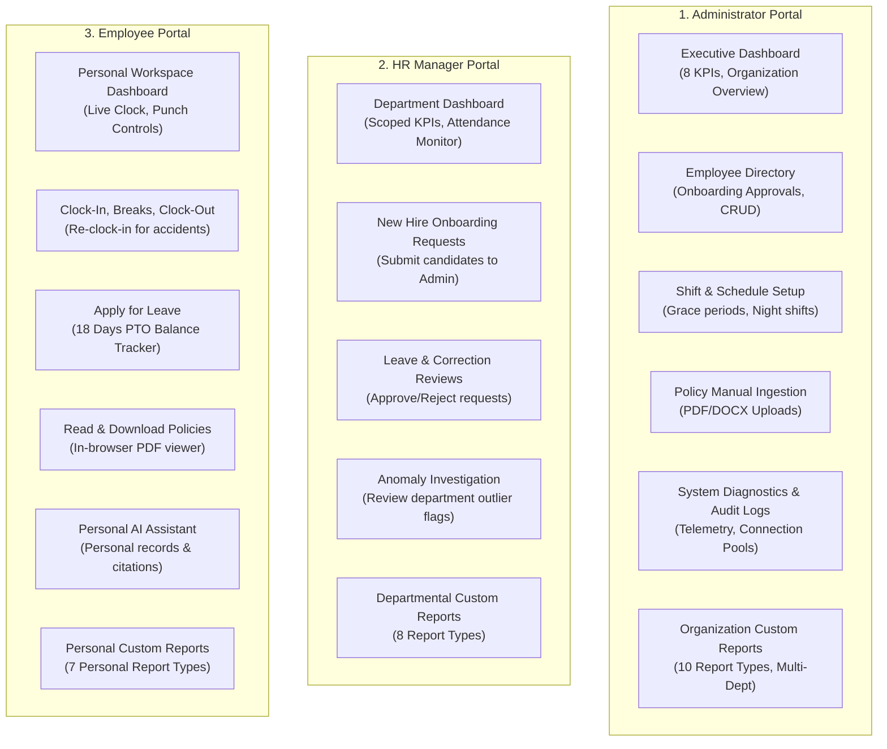
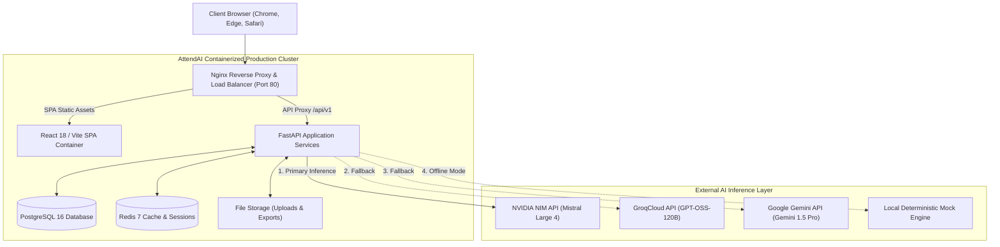
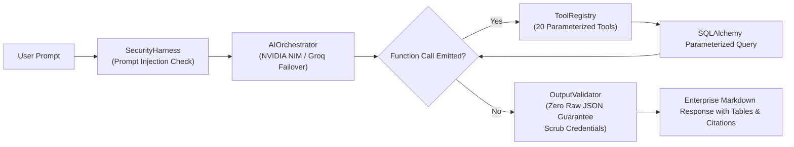

# AttendAI
### Intelligent Workforce. Smarter Decisions.

[](https://attendai-intelligent-workforce.onrender.com/)

🌐 **Live Production Application**: [https://attendai-intelligent-workforce.onrender.com/](https://attendai-intelligent-workforce.onrender.com/)

[](https://python.org)
[](https://fastapi.tiangolo.com)
[](https://react.dev)
[](https://www.typescriptlang.org)
[](https://tailwindcss.com)
[](https://build.nvidia.com)
[](https://groq.com)
[-brightgreen.svg)]()

AttendAI is a production-grade, AI-powered workforce time-and-attendance management platform engineered with a Dayforce-inspired enterprise user experience. It unifies deterministic attendance calculation, unsupervised machine learning anomaly detection, grounded tool-augmented AI orchestrations, in-browser policy document extraction, and a custom report builder.

---

## Table of Contents
- [1. Problem Statement](#1-problem-statement)
- [2. Motivation and Objectives](#2-motivation-and-objectives)
- [3. Key Features](#3-key-features)
- [4. Role-Based User Portals](#4-role-based-user-portals)
- [5. Technology Stack](#5-technology-stack)
- [6. System Architecture Overview](#6-system-architecture-overview)
- [7. Core Application Modules](#7-core-application-modules)
- [8. AI & Machine Learning Architecture](#8-ai--machine-learning-architecture)
- [9. Database Architecture](#9-database-architecture)
- [10. Security & Authorization Architecture](#10-security--authorization-architecture)
- [11. Custom Reporting & Exports Engine](#11-custom-reporting--exports-engine)
- [12. Visual Walkthrough & Screenshots](#12-visual-walkthrough--screenshots)
- [13. Repository Folder Structure](#13-repository-folder-structure)
- [14. Quickstart & Installation](#14-quickstart--installation)
- [15. Demonstration Accounts](#15-demonstration-accounts)
- [16. Quality Assurance & Automated Testing](#16-quality-assurance--automated-testing)
- [17. Troubleshooting & Diagnostics](#17-troubleshooting--diagnostics)
- [18. Known Limitations & Roadmap](#18-known-limitations--roadmap)
- [19. Complete Documentation Library](#19-complete-documentation-library)

---

## 1. Problem Statement
Enterprise time-and-attendance operations routinely suffer from four systemic vulnerabilities:
1. **Disconnected Information Silos**: Time clocks, shift rosters, leave requests, and corporate policy manuals exist across segregated applications, forcing HR managers to cross-reference multiple disjointed spreadsheets.
2. **Brittle Anomaly Detection**: Basic rule-based alerts either flood supervisors with false alarms or fail to catch subtle, correlated punch discrepancies before payroll deadlines.
3. **Black-Box AI and Hallucinations**: Standard chatbots lack direct parameterized access to organizational databases, leading to hallucinations, security breaches, or direct SQL execution vulnerabilities.
4. **Poor Reporting Flexibility**: Legacy HR software provides either rigid canned reports or slow raw CSV dumps without executive summaries, KPI visualizations, or role-scoped data filtering.

---

## 2. Motivation and Objectives
AttendAI was designed to solve these vulnerabilities by coupling a **mathematically deterministic attendance engine** with a **sandboxed AI execution harness**:
- **Audit-Proof Determinism**: Time calculations (grace periods, overtime, break durations) are computed strictly by deterministic Python and SQL rules with zero LLM guesswork.
- **Explainable Anomaly Detection**: Combines deterministic compliance rules (>180m overtime, >12h shifts, repeated tardiness) with Scikit-Learn `IsolationForest` statistical outlier detection.
- **Grounded AI Workforce Assistant**: Enables managers and employees to query live databases using natural language, backed by approved parameterized tools, prompt injection guardrails, and automated multi-provider failover.
- **In-Browser Policy Retrieval**: Ingests actual PDF, DOCX, and TXT employee handbooks and provides interactive reading, full-text chunk indexing, and page/section citations.
- **Executive Custom Report Builder**: Multi-step interactive builder allowing role-based data scoping, live record preview, and generation of styled Excel workbooks with embedded charts.

---

## 3. Key Features

- **Time & Attendance Tracking**:
  - Server-timestamped clock-in, clock-out, and break management.
  - Automatic 15-minute shift grace period enforcement.
  - Automatic overtime calculation beyond scheduled shift hours.
  - Re-clock-in / resume-shift capability for accidental clock-outs.
  - Manual attendance correction workflow with mandatory audit rationale.
- **Hybrid Anomaly Detection**:
  - Deterministic rules: Missing punches, excessive overtime, abnormal breaks, repeated late arrivals.
  - Machine learning: Multidimensional `IsolationForest` on worked minutes, overtime, and late minutes.
  - Human-in-the-loop ethical AI review: Anomalies are informational indicators for manager investigation, never automated penalties.
- **Conversational AI Workforce Assistant**:
  - Primary provider: NVIDIA NIM (`mistralai/mistral-large-4-1t-a52b`).
  - Automated secondary failover: GroqCloud (`openai/gpt-oss-120b`).
  - Tertiary / Development: Google Gemini (`gemini-1.5-pro`) and deterministic Mock engine.
  - Approved tool calling across 20 parameterized functions.
  - Zero raw JSON guarantee: Formats all outputs as professional enterprise Markdown tables and bulleted insights.
- **Policy Management & Viewer**:
  - Upload PDF, DOCX, and TXT company guidelines.
  - In-browser interactive reader supporting multi-page PDF zoom and structured DOCX rendering.
  - Full-text keyword search returning exact document, page, and section citations.
  - Direct authenticated file downloads.
- **Enterprise Custom Report Builder**:
  - Interactive modal: *"What would you like to download?"*.
  - Scoping: Entire organization, authorized departments, individual employees, or personal records.
  - Formats: Clean RFC-4180 CSV and executive-grade Excel (`.xlsx`).
  - Excel structure: Executive Cover Sheet + KPI Cards + Native PieChart + Frozen Header Itemized Details Sheet + Auto-Filters + Zebra Striping + Formula Totals (`=SUM(...)`) + Department Bar Chart.
  - Persistent export history ledger (`export_records`).

---

## 4. Role-Based User Portals

AttendAI enforces strict three-tier role-based access control (RBAC):



---

## 5. Technology Stack

| Layer | Technologies | Purpose |
| :--- | :--- | :--- |
| **Backend Framework** | **Python 3.12**, **FastAPI 1.0.0**, **Uvicorn** | Asynchronous REST API, dependency injection, async pipeline |
| **Database & ORM** | **PostgreSQL 16**, **SQLAlchemy 2.0 (Async)**, **Alembic** | Relational database, async engine via `asyncpg`, SQLite fallback |
| **Caching & Session** | **Redis 7 Alpine**, **FakeRedis** | Distributed cache, JWT session tracking, rate limiting |
| **Frontend Framework**| **React 18**, **TypeScript 5**, **Vite** | Single-page application, type safety, sub-second HMR |
| **UI & Styling** | **Tailwind CSS 3**, **Lucide Icons** | Dayforce-grade enterprise aesthetics, responsive typography |
| **Primary AI Engine** | **NVIDIA NIM API** (`mistralai/mistral-large-4-1t-a52b`) | High-reasoning workforce analytics, complex tool execution |
| **Fallback AI Engine**| **GroqCloud API** (`openai/gpt-oss-120b`) | Ultra-fast (<500ms) automated failover for resilient uptime |
| **Tertiary AI Engine**| **Google Gemini API** (`gemini-1.5-pro`) | Optional multi-provider cloud adapter |
| **Machine Learning** | **Scikit-Learn** (`IsolationForest`), **NumPy** | Unsupervised multivariate attendance anomaly detection |
| **Document Engine** | **PyMuPDF (`fitz`)**, **python-docx** | Real PDF/DOCX page-by-page text extraction and chunk indexing |
| **Report Generation** | **OpenPyXL**, Python `csv` module | Executive workbooks with embedded charts, formulas, and CSV |
| **Containerization** | **Docker**, **Docker Compose**, **Nginx Alpine** | Multi-replica production cluster, least_conn load balancer |
| **Testing** | **pytest**, **vitest**, **Playwright**, **Locust** | 85 backend tests, frontend unit tests, E2E browser journeys |

---

## 6. System Architecture Overview



For complete architecture diagrams and sequence workflows, see [Architecture Documentation](docs/architecture.md).

---

## 7. Core Application Modules

1. **Authentication & Session (`/api/v1/auth`)**: JWT with HS256, Argon2 password hashing, 15m access tokens, 7d refresh token rotation.
2. **Workforce Management (`/api/v1/employees`, `/departments`)**: Employee CRUD, department hierarchy, two-tier HR onboarding request submission and Admin authorization.
3. **Scheduling & Shifts (`/api/v1/shifts`)**: Configurable shifts, night shift support, grace periods, employee shift assignments.
4. **Time & Attendance (`/api/v1/attendance`)**: Clock-in/out, intermittent break tracking, re-clock-in/resume shift, manager correction audits with mandatory justification.
5. **Leave Management (`/api/v1/leave`)**: Employee time-off requests, PTO balance deduction, manager approval/rejection workflows.
6. **Anomaly Detection (`/api/v1/anomalies`)**: Rule-based alerts and Scikit-Learn Isolation Forest outlier detection with human-in-the-loop review.
7. **Policy Management (`/api/v1/policies`)**: Document uploading, PyMuPDF extraction, in-browser PDF/DOCX viewer, full-text chunk search.
8. **Workforce Analytics (`/api/v1/analytics`)**: Real-time KPI aggregation for Admin/HR dashboards and personal metrics for Employee dashboards.
9. **Custom Report Builder (`/api/v1/exports`)**: Multi-step interactive popup, live preview, CSV, and executive-grade multi-sheet Excel generation.
10. **AI Workforce Assistant (`/api/v1/ai`)**: Grounded natural language conversational assistant with 20 parameterized tools, prompt injection defense, and secret scrubbing.
11. **Notifications Center (`/api/v1/notifications`)**: 10 event categories, priority indicators, unread count badges, and notification preferences.
12. **Global Search (`/api/v1/search`)**: Keyboard-navigated (`Cmd/Ctrl + K`) cross-entity search with strict role-level authorization.
13. **System Diagnostics (`/api/v1/system`)**: Admin-only telemetry, connection pool monitoring, memory diagnostics, and immutable audit logs.

---

## 8. AI & Machine Learning Architecture



### Approved Tool Permissions Matrix
- **Employee Personal Tools (9 Tools)**: `get_my_attendance`, `get_my_attendance_summary`, `get_my_overtime`, `get_my_late_arrivals`, `get_my_working_hours`, `get_my_leave_balance`, `get_my_shifts`, `get_my_attendance_history`, `search_attendance_policy`.
- **Workforce-Wide Tools (11 Tools - Admin/HR Only)**: `query_workforce_attendance`, `compare_workforce_metrics`, `query_leave_analytics`, `get_late_arrivals`, `get_employee_overtime`, `get_absenteeism`, `get_department_analytics`, `get_workforce_correlations`, `get_attendance_summary`, `get_anomaly_reports`, `get_employee_profile`.

For complete AI specifications, see [AI & Machine Learning Documentation](docs/ai-and-ml.md) and [LLM Provider Setup](docs/llm-provider-setup.md).

---

## 9. Database Architecture

AttendAI organizes data across 21 relational tables under a strict multi-tenant boundary:

```
organizations
  ├── departments
  ├── users ── refresh_tokens, notifications, notification_preferences, conversations
  ├── employees ── shift_assignments, attendance_records, breaks, corrections, leave, anomalies
  ├── shifts
  ├── policies ── policy_chunks
  ├── employee_onboarding_requests
  ├── export_records
  └── audit_logs
```

For complete table definitions, data types, indexes, and constraints, see [Database Schema Documentation](docs/database-schema.md).

---

## 10. Security & Authorization Architecture

- **Cryptographic Hashing**: Passwords stored using **Argon2id** (`argon2-cffi`).
- **Token Security**: Dual-token lifecycle (15-minute access JWT + 7-day refresh token rotation).
- **Silent RBAC**: Technical security panels and scope banners are suppressed from user interfaces; unauthorized actions silently redirect to `/403`.
- **IDOR Immunity**: Personal employee queries bind automatically to the authenticated session (`current_employee.id`).
- **File Validation**: Policy uploads validate binary MIME signatures; executable formats (`.exe`, `.sh`, `.php`, `.py`) are rejected.
- **AI Defense**: Prompt injection detection intercepts jailbreak attempts; output validator redacts JWTs and API keys.

For complete security details, see [Security Architecture Documentation](docs/security.md).

---

## 11. Custom Reporting & Exports Engine

Clicking any **Export** button opens the custom report builder dialog (*"What would you like to download?"*):
1. **Report Type Selection**: 10 Admin types, 8 HR types, 7 Employee types.
2. **Data Scope**: Organization, Department, Single Employee, or Personal.
3. **Date Filters**: 9 presets (*Today, This Month, Last 30 Days*, etc.) or Custom Date Range.
4. **Column Registry**: Checkboxes with *Select All* and *Restore Defaults*.
5. **Live Record Preview**: Calls `/api/v1/exports/preview` to verify count before downloading.
6. **Executive Excel Structure**:
   - *Report Summary Sheet*: Executive cover, two-column metadata card, dynamic KPI dashboard cards, attendance distribution table, and native openpyxl `PieChart`.
   - *Itemized Records Sheet*: Deep navy `#1E3A8A` header, frozen pane at `A5`, auto-filters, zebra striping, status badges, formula totals `=SUM(...)`, landscape print setup.
   - *Department Summary Sheet*: Multi-department breakdown with native openpyxl `BarChart` comparing worked hours.

For complete reporting documentation, see [Reporting & Exports Documentation](docs/reporting-and-exports.md).

---

## 12. Visual Walkthrough & Screenshots

```
+---------------------------------------------------------------------------------------+
|  [Screenshot Placeholder 1: Administrator Executive Dashboard]                         |
|  Caption: Executive workforce KPI cards, department performance, and live trends.     |
+---------------------------------------------------------------------------------------+

+---------------------------------------------------------------------------------------+
|  [Screenshot Placeholder 2: Employee Workspace Portal & Punch Controls]                |
|  Caption: Live shift clock, punch buttons (Clock In, Start Break, Clock Out).         |
+---------------------------------------------------------------------------------------+

+---------------------------------------------------------------------------------------+
|  [Screenshot Placeholder 3: Custom Report Builder Modal]                              |
|  Caption: Multi-step dialog: "What would you like to download?" with live preview.    |
+---------------------------------------------------------------------------------------+

+---------------------------------------------------------------------------------------+
|  [Screenshot Placeholder 4: Redesigned Executive Excel Report (.xlsx)]                |
|  Caption: OpenPyXL executive cover sheet with KPI cards, pie chart, and freeze panes. |
+---------------------------------------------------------------------------------------+

+---------------------------------------------------------------------------------------+
|  [Screenshot Placeholder 5: In-Browser Policy Document Viewer]                        |
|  Caption: Full-page PDF reader with page navigation, zoom, and direct download.       |
+---------------------------------------------------------------------------------------+
```

---

## 13. Repository Folder Structure

```
DayForce/
├── .env.example                     # Reference environment configuration
├── docker-compose.yml               # Production multi-replica container orchestration
├── pytest.ini                       # Pytest configuration & test options
├── QA_REPORT.md                     # Comprehensive QA test execution ledger
├── README.md                        # Master project documentation
│
├── backend/
│   ├── Dockerfile                   # Python 3.12 container specification
│   ├── requirements.txt             # Production backend dependencies
│   ├── alembic/                     # Database migrations
│   ├── app/
│   │   ├── main.py                  # FastAPI application entrypoint & middleware
│   │   ├── api/                     # REST API routers & dependency injection
│   │   │   ├── deps.py              # JWT authentication & RBAC dependencies
│   │   │   └── v1/                  # Version 1 endpoints (auth, attendance, shifts...)
│   │   ├── cache/                   # Redis client & FakeRedis fallback
│   │   ├── core/                    # App config, database session, security, exceptions
│   │   ├── exports/                 # Custom report builder, CSV & Excel generators
│   │   ├── harness/                 # AI Orchestrator, providers, tools, guardrails
│   │   ├── models/                  # SQLAlchemy 2.0 ORM models (21 tables)
│   │   ├── schemas/                 # Pydantic v2 validation schemas
│   │   └── services/                # Business services (attendance, anomaly, policy)
│   └── tests/                       # 85 automated pytest suites
│
├── frontend/
│   ├── Dockerfile                   # Node multi-stage build serving static SPA
│   ├── package.json                 # React 18, Vite, TypeScript dependencies
│   ├── src/
│   │   ├── app/                     # App.tsx route hierarchy with RoleGuard
│   │   ├── components/              # Layout, ExportModal, DocumentViewerModal...
│   │   ├── context/                 # AuthContext (JWT lifecycle & user state)
│   │   ├── pages/                   # Role dashboards, Attendance, Shifts, Policies...
│   │   └── services/                # Axios API client with automatic token refresh
│
├── docs/                            # In-depth technical documentation manuals
│   ├── architecture.md              # System architecture & sequence workflows
│   ├── database-schema.md           # ER diagram & 21 table specifications
│   ├── api-reference.md             # Complete 61 REST endpoint reference
│   ├── ai-and-ml.md                 # AI harness, providers, tools, Isolation Forest
│   ├── llm-provider-setup.md        # Step-by-step NVIDIA, Groq, Gemini setup
│   ├── setup-and-installation.md    # Windows & Linux step-by-step setup
│   ├── user-guide.md                # Admin, HR Manager & Employee user manual
│   ├── reporting-and-exports.md     # Custom report builder & Excel architecture
│   ├── security.md                  # Security, threat mitigation & audit logs
│   ├── testing.md                   # Pytest, Vitest, Playwright & Locust guides
│   ├── deployment.md                # Docker, Nginx, load balancing & backups
│   ├── ai-contribution-analysis.md  # Engineering analysis of AI contributions
│   └── troubleshooting.md           # Copy-paste diagnostics & bug resolutions
│
├── nginx/
│   └── nginx.conf                   # Upstream load balancing & reverse proxy config
├── sample_data/
│   └── seed.py                      # Database seeder (200 employees, shifts, records)
└── tests/
    └── locustfile.py                # Performance load testing script
```

---

## 14. Quickstart & Installation

### Option A: Launch with Docker Compose (Recommended)
```bash
docker-compose up -d --build
```
Access the application at `http://localhost:80` (or `http://localhost:3000`).

---

### Option B: Local Installation (Windows PowerShell)

```powershell
# 1. Clone repository
git clone https://github.com/shuvendu-kumar-mohapatra/attendai-intelligent-workforce.git
cd attendai-intelligent-workforce

# 2. Configure environment
Copy-Item .env.example .env

# 3. Setup Backend Environment
python -m venv venv
.\venv\Scripts\Activate.ps1
pip install -r backend/requirements.txt

# 4. Setup Frontend Environment
npm --prefix frontend install

# 5. Initialize Database & Seed Demonstration Data
$env:PYTHONPATH="backend"
.\venv\Scripts\python.exe sample_data/seed.py

# 6. Start Backend (Terminal 1)
$env:PYTHONPATH="backend"
.\venv\Scripts\python.exe -m uvicorn app.main:app --reload --host 127.0.0.1 --port 8000

# 7. Start Frontend (Terminal 2)
npm --prefix frontend run dev -- --port 3000 --host 127.0.0.1
```

---

### Option C: Local Installation (Linux / macOS)

```bash
# 1. Clone repository
git clone https://github.com/shuvendu-kumar-mohapatra/attendai-intelligent-workforce.git
cd attendai-intelligent-workforce

# 2. Configure environment
cp .env.example .env

# 3. Setup Backend Environment
python3 -m venv venv
source venv/bin/activate
pip install -r backend/requirements.txt

# 4. Setup Frontend Environment
npm --prefix frontend install

# 5. Initialize Database & Seed Demonstration Data
PYTHONPATH=backend ./venv/bin/python sample_data/seed.py

# 6. Start Backend (Terminal 1)
PYTHONPATH=backend ./venv/bin/python -m uvicorn app.main:app --reload --host 127.0.0.1 --port 8000

# 7. Start Frontend (Terminal 2)
npm --prefix frontend run dev -- --port 3000 --host 127.0.0.1
```

For full installation details, see [Setup & Installation Guide](docs/setup-and-installation.md).

---

## 15. Demonstration Accounts

> [!TIP]
> You can test these accounts immediately on the live production deployment at **[https://attendai-intelligent-workforce.onrender.com/](https://attendai-intelligent-workforce.onrender.com/)** without needing to install anything locally.

The database seeder provisions verified demonstration accounts with active shifts and attendance histories:

| Role | Email | Password | Primary Interface |
| :--- | :--- | :--- | :--- |
| **Administrator** | `admin@attendai.com` | `Admin@123` | Executive org dashboard, shift configuration, onboarding authorization, system diagnostics |
| **HR Manager** | `hrmanager@attendai.com` | `HRManager@123` | Department attendance monitoring, employee onboarding submission, leave reviews |
| **Employee** | `employee@attendai.com` | `Employee@123` | Personal clock-in/out, schedule, leave balance, policy viewer, personal reports |

---

## 16. Quality Assurance & Automated Testing

AttendAI is verified across 85 automated backend tests, 7 frontend unit tests, 3 Playwright browser E2E journeys, and Locust load tests:

```bash
# Run complete backend pytest suite (Windows PowerShell)
$env:PYTHONPATH="backend"
.\venv\Scripts\pytest.exe backend/tests/ -v

# Run complete backend pytest suite (Linux / macOS)
PYTHONPATH=backend ./venv/bin/pytest backend/tests/ -v

# Run frontend Vitest unit suite
npm --prefix frontend test

# Run Playwright browser E2E tests
npx playwright test

# Run Locust performance load test
locust -f tests/locustfile.py --headless -u 10 -r 2 -t 30s --host http://localhost:8000
```

**Verified Test Results**:
- **Backend Pytest**: **85 / 85 Passed (100%)**
- **Frontend Vitest**: **7 / 7 Passed (100%)**
- **Playwright Chromium E2E**: **3 / 3 Portals Passed (100%)**
- **Locust Load Test**: **71 Requests, 0 Failures (0.00%)**, Median: 22ms.

For detailed test reports, see [Testing Reference](docs/testing.md) and [QA Report](QA_REPORT.md).

---

## 17. Troubleshooting & Diagnostics

- **Port 8000 or 3000 Busy**: Terminate conflicting processes (`Get-NetTCPConnection` on Windows or `lsof -ti:8000 | xargs kill -9` on Linux).
- **PostgreSQL Unavailable**: AttendAI automatically falls back to `sqlite+aiosqlite:///./attendai.db` if `USE_SQLITE_FALLBACK=true` in `.env`.
- **Redis Unavailable**: AttendAI automatically falls back to in-memory `FakeRedis` if `USE_FAKEREDIS_FALLBACK=true` in `.env`.
- **Cloud LLM Quota / No API Keys**: Set `LLM_PROVIDER=mock` in `.env` to execute deterministic local AI queries with zero external dependencies.

For complete solutions to common issues, see [Troubleshooting Guide](docs/troubleshooting.md).

---

## 18. Known Limitations & Roadmap

### Current Scope & Limitations
- Biometric hardware integration is simulated via web punch buttons and REST API payloads rather than direct TCP socket hardware listeners.
- Cloud LLM latency is bound to external API roundtrips (~2.5s for NVIDIA NIM, ~500ms for GroqCloud).
- PDF document downloads are supported in the Policy section; custom report exports are focused on formatted Excel (`.xlsx`) and CSV (`.csv`).

### Planned Future Roadmap
1. **Geofencing & Mobile Punch**: Integration with GPS coordinates and mobile progressive web app (PWA) clock-in boundaries.
2. **Shift Auto-Rostering**: Integer linear programming (ILP) algorithm to automatically generate optimal monthly shift rosters based on labor compliance rules and employee preferences.
3. **Hardware Biometric Terminal Bridge**: Native MQTT/TCP listener daemon for physical ZKTeco and Anviz fingerprint/facial recognition terminals.

---

## 19. Complete Documentation Library

Explore the full documentation suite in the `docs/` directory:

1. 🏛️ [System Architecture & Interaction Workflows](docs/architecture.md)
2. 🗄️ [Database Schema & ER Specifications](docs/database-schema.md)
3. 🔌 [Complete REST API Reference (61 Endpoints)](docs/api-reference.md)
4. 🤖 [AI & Machine Learning Architecture](docs/ai-and-ml.md)
5. 🔑 [LLM Provider Setup & Failover Guide](docs/llm-provider-setup.md)
6. 💻 [Complete Setup & Installation Guide](docs/setup-and-installation.md)
7. 📖 [Role-Based User Guide (Admin, HR, Employee)](docs/user-guide.md)
8. 📊 [Reporting, Analytics & Custom Exports](docs/reporting-and-exports.md)
9. 🛡️ [Security, Threat Mitigation & Audit Logs](docs/security.md)
10. 🧪 [Quality Assurance & Testing Reference](docs/testing.md)
11. 🚀 [Production Deployment & Infrastructure](docs/deployment.md)
12. 📈 [AI Contribution & Technical Impact Analysis](docs/ai-contribution-analysis.md)
13. 🛠️ [Troubleshooting & Diagnostics Guide](docs/troubleshooting.md)

---

## Contributors

- Vaishnavi R Kannur
- Priyanka
- C Sandhya
- Shuvendu Kumar Mohapatra

---

### License & Compliance
AttendAI is distributed under the MIT License. Enterprise deployments must adhere to local statutory labor guidelines regarding employee attendance monitoring and timecard record retention.
